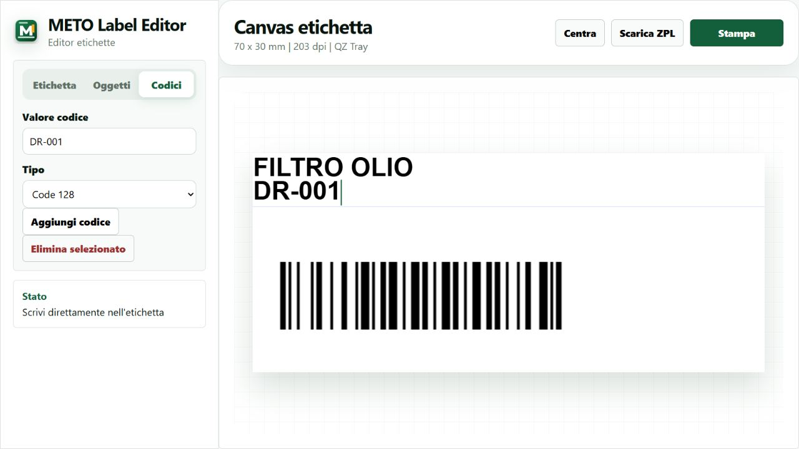
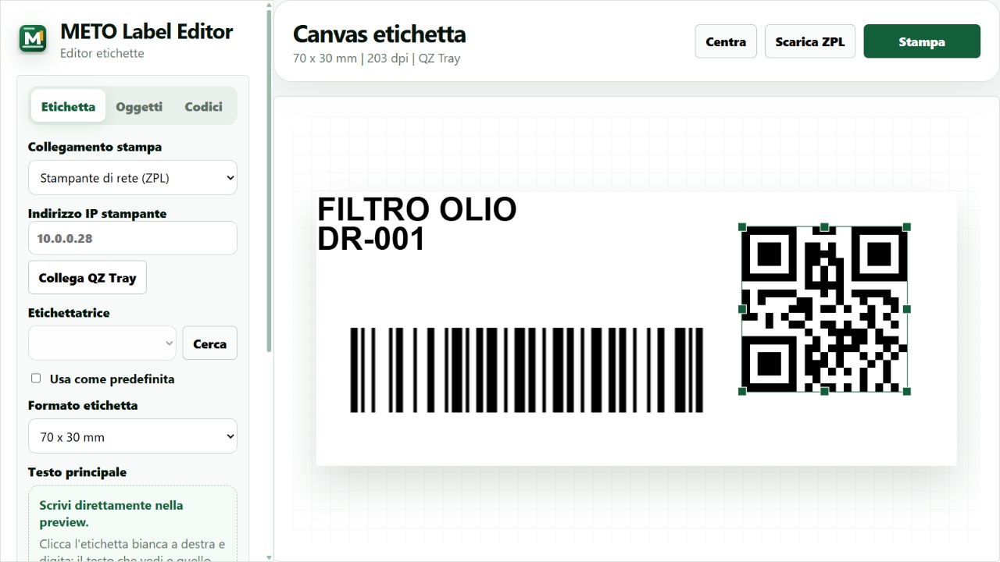

# METO Label Editor — Odoo 19, Cloudflare e QZ Tray

METO compone e stampa etichette per ricambi con testo, SKU, barcode, QR, immagini, linee e riquadri. L'editor gira nel browser ed è distribuito da Cloudflare; QZ Tray sul PC invia la stampa.

## Stato verificato il 19 ottobre 2026
- Editor online: https://meto-label-editor.ecommerce-d86.workers.dev
- Modulo importabile `meto_label_editor` versione 19.0.3.1.0 installato/aggiornato su https://drricambi.it tramite Applicazioni > Importa modulo.
- Apertura dall'icona METO verificata: l'iframe carica Cloudflare, senza errore 404.
- Apertura da un prodotto esistente > Azioni > Apri in METO verificata: nome e codice articolo ricevuti nel canvas e nel campo Codici. Nessuna modifica alla scheda prodotto, nessuna stampa inviata.
- La stampa fisica deve ancora essere provata sulla postazione con QZ Tray.

## Integrazione importabile, senza controller Python
L'addon contiene metadata, XML e JavaScript. `__init__.py` è vuoto; non sono presenti controller o modelli Python personalizzati. Odoo supporta questi moduli dati importabili via ZIP, quindi non serve caricare Python aggiuntivo sul server o riavviarlo.
Il JavaScript legge i prodotti mediante il servizio ORM dell'utente Odoo e rispetta i suoi permessi. I dati passano direttamente dal browser Odoo all'iframe Cloudflare con postMessage: sono verificati origine, finestra e canale casuale. Non vengono messi nell'URL o inviati alle API del Worker.
L'origine dell'editor è nel file `meto_label_editor/static/src/action.js`. Non servono parametri di sistema o chiamate a /meto/editor e /meto/config. Eventuali parametri creati per le precedenti versioni non sono usati.

## Installare o aggiornare
1. Creare uno ZIP con la directory radice `meto_label_editor`, mantenendo il nome tecnico esistente.
2. In Odoo, modalità sviluppatore > Applicazioni > Importa modulo, caricare lo ZIP e premere Installa. Non occorre disinstallare prima. Non caricare dati demo.
3. Ricaricare Odoo e aprire METO. Per un prodotto usare Azioni > Apri in METO. Il barcode, se presente, è proposto nel campo Codici; va aggiunto esplicitamente dall'utente.
4. Avviare QZ Tray sul PC, collegarlo dall'editor e selezionare una stampante compatibile raw/ZPL o IPv4:9100. Provare prima Scarica ZPL e poi una sola etichetta.
Il server con accesso al filesystem può anche distribuire lo stesso addon via Git. La modifica non richiede di unire i vecchi addon storici a una versione Odoo diversa: Stefano deve confermare il repository di produzione effettivo.

## Cloudflare
`meto/cloudflare` contiene il progetto Worker con asset statici. Da questa directory: `npm ci`, `npm run check`, `npm run deploy` con accesso Cloudflare autorizzato. `wrangler.jsonc` consente l'incorporamento da https://drricambi.it; aggiungere soltanto eventuali origini staging reali.
Non è necessario eseguire Python su Cloudflare: disegno e conversione ZPL sono JavaScript nel browser. Il Worker serve configurazione e intestazioni CSP, non proxy al database Odoo.

## Funzioni e limiti
Formati 55×25, 70×30 e 100×100 mm a 203 dpi, correzione 3 mm a destra per 70×30; testo e oggetti modificabili, Code128/Code39/EAN-13/QR, foto con soglia/dithering, annulla/ripristina e download ZPL. Nessun archivio persistente delle etichette.
La stampa QZ usa conferme di autorizzazione; firma e certificato per stampa senza conferme non sono inclusi. Mai inserire chiavi private negli asset pubblici. Le stampanti devono accettare ZPL, i driver locali raw.

## Verifiche
Test automatici Worker, protocollo di messaggi e raster ZPL superati; parsing XML e sintassi JS; importazione e apertura effettive su Odoo verificate. Gli screenshot seguenti usano dati dimostrativi dell'anteprima locale. Il test reale di un prodotto è documentato localmente senza pubblicare dati della base Odoo.

Fabric.js 5.3.0, JsBarcode 3.12.1, QRCode dalla distribuzione METO originale; QZ JS 2.2.5 dall'installazione locale. Avvisi e QZ_LICENSE.txt conservati.

## Aggiornamento QZ Tray — 19 ottobre 2026
Modulo 19.0.3.1.0 installato: delega esplicita del permesso di rete locale all’iframe Cloudflare. Aggiunti verifica HTTPS locale, stato visibile e scadenza della connessione, pulsante Verifica IP senza stampare e ricerca sui soli indirizzi configurati (nessuna scansione dell’intera rete). La ricerca PC usa le stampanti installate; la ricerca rete verifica TCP 9100 senza inviare dati di stampa.

Superati 12 test automatici. QZ Tray 2.2.5 risponde sul PC e la porta della stampante risponde. Nel browser di collaudo il permesso locale risulta ancora da autorizzare e la connessione non è confermata: stampa fisica ancora da verificare. Non vengono disabilitate protezioni o conferme QZ.
